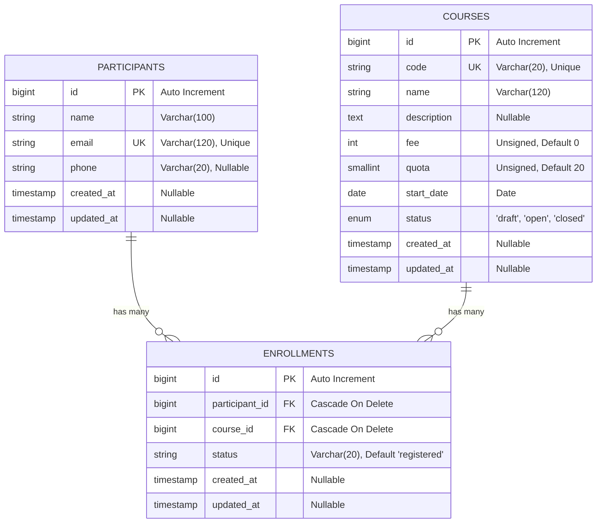

# Entity Relationship Diagram (ERD) — Pertemuan 12 KursusKu Laravel
**Database:** MySQL (`kursus_dea`)  
**Format:** Mermaid Class/ER Diagram & Tabular Schema  

---

## 1. Visualisasi ERD Tiga Entitas

---

## 2. Struktur Tabel & Constraint Detail

### A. Tabel `participants`
| Field | Tipe Data | Key / Index | Constraint / Default | Keterangan |
|---|---|---|---|---|
| `id` | `BIGINT UNSIGNED` | Primary Key | `AUTO_INCREMENT` | Identitas unik peserta |
| `name` | `VARCHAR(100)` | - | `NOT NULL` | Nama lengkap peserta |
| `email` | `VARCHAR(120)` | Unique Key | `NOT NULL`, `UNIQUE` | Alamat email unik peserta |
| `phone` | `VARCHAR(20)` | - | `NULL` | Nomor telepon kontak (opsional) |
| `created_at` | `TIMESTAMP` | - | `NULL` | Waktu registrasi peserta |
| `updated_at` | `TIMESTAMP` | - | `NULL` | Waktu modifikasi data peserta |

### B. Tabel `courses`
| Field | Tipe Data | Key / Index | Constraint / Default | Keterangan |
|---|---|---|---|---|
| `id` | `BIGINT UNSIGNED` | Primary Key | `AUTO_INCREMENT` | Identitas unik kursus |
| `code` | `VARCHAR(20)` | Unique Key | `NOT NULL`, `UNIQUE` | Kode unik kursus (misal: WEB-101) |
| `name` | `VARCHAR(120)` | - | `NOT NULL` | Nama program kursus |
| `description` | `TEXT` | - | `NULL` | Rincian materi kursus |
| `fee` | `INT UNSIGNED` | - | `DEFAULT 0` | Biaya pelatihan |
| `quota` | `SMALLINT UNSIGNED`| - | `DEFAULT 20` | Daya tampung peserta |
| `start_date` | `DATE` | - | `NOT NULL` | Tanggal mulai kursus |
| `status` | `ENUM` | - | `'draft','open','closed'` | Status pendaftaran kursus |
| `created_at` | `TIMESTAMP` | - | `NULL` | Waktu pembuatan kursus |
| `updated_at` | `TIMESTAMP` | - | `NULL` | Waktu pembaruan kursus |

### C. Tabel `enrollments` (Tabel Pivot Relasi)
| Field | Tipe Data | Key / Index | Constraint / Default | Keterangan |
|---|---|---|---|---|
| `id` | `BIGINT UNSIGNED` | Primary Key | `AUTO_INCREMENT` | Identitas unik pendaftaran |
| `participant_id`| `BIGINT UNSIGNED` | Foreign Key, Composite UK | `REFERENCES participants(id) ON DELETE CASCADE` | ID peserta terdaftar |
| `course_id` | `BIGINT UNSIGNED` | Foreign Key, Composite UK | `REFERENCES courses(id) ON DELETE CASCADE` | ID kursus yang didaftar |
| `status` | `VARCHAR(20)` | - | `DEFAULT 'registered'` | Status enrollment |
| `created_at` | `TIMESTAMP` | - | `NULL` | Waktu enrollment |
| `updated_at` | `TIMESTAMP` | - | `NULL` | Waktu modifikasi status |

---

## 3. Karakteristik Foreign Key & Keunikan Komposit
1. **Aturan Keunikan:**  
   `UNIQUE KEY enrollments_participant_id_course_id_unique (participant_id, course_id)`  
   - Kolom `participant_id` tidak unik secara individual &rarr; 1 peserta bisa mendaftar banyak kursus.
   - Kolom `course_id` tidak unik secara individual &rarr; 1 kursus bisa diikuti banyak peserta.
   - Pasangan keduanya unik &rarr; 1 peserta tidak bisa mendaftar kursus yang sama lebih dari satu kali.
2. **Aturan Referensial & Integritas:**  
   - `ON DELETE CASCADE`: Menjamin bila record pada tabel induk (`courses` atau `participants`) dihapus, maka record turunan pada tabel perantara (`enrollments`) ikut dihapus secara otomatis oleh engine InnoDB MySQL tanpa meninggalkan record yatim (*orphan data*).
