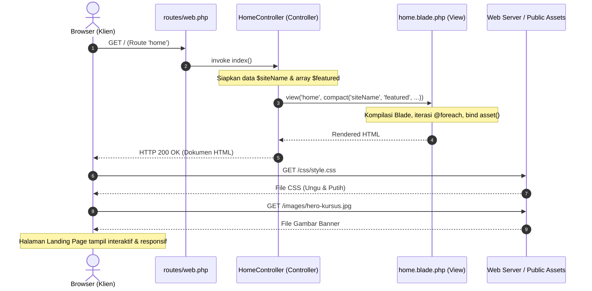

# Diagram & Penjelasan Request Lifecycle KursusKu

Dokumentasi alur siklus permintaan (*request lifecycle*) pada aplikasi **KursusKu Laravel** untuk materi Praktikum Pertemuan 7 (Arsitektur MVC: Route, Controller, View, dan Asset).

---

## 1. Diagram Alur Permintaan

```text
+-----------------------------------------------------------------------+
|                              BROWSER                                  |
|         Pengguna mengakses URL: http://localhost:8000/                |
+-----------------------------------------------------------------------+
                                   |
                         (1) HTTP GET Request /
                                   v
+-----------------------------------------------------------------------+
|                          routes/web.php                               |
|   Route::get('/', [HomeController::class, 'index'])->name('home');    |
|   Mencocokkan metode HTTP dan URI, lalu memanggil Controller          |
+-----------------------------------------------------------------------+
                                   |
               (2) Memanggil method HomeController@index
                                   v
+-----------------------------------------------------------------------+
|             app/Http/Controllers/HomeController.php                   |
|   - Menyiapkan variabel $siteName                                     |
|   - Menyiapkan array data kursus $featured (code, name, desc, dll)    |
|   - Mengirim data ke View menggunakan compact()                       |
|   - Mengembalikan response: return view('home', compact(...))         |
+-----------------------------------------------------------------------+
                                   |
                  (3) Render Template dengan Data
                                   v
+-----------------------------------------------------------------------+
|                   resources/views/home.blade.php                      |
|   - Menampilkan variabel teks dengan sintaks {{ $siteName }}          |
|   - Merender perulangan data katalog kursus dengan @foreach           |
|   - Menghubungkan aset melalui helper asset('css/style.css')          |
|   - Menghubungkan aset gambar melalui asset('images/hero-kursus.jpg') |
|   - Menghasilkan markup dokumen HTML lengkap                          |
+-----------------------------------------------------------------------+
                                   |
              (4) HTTP Response (Status 200 OK, Content HTML)
                                   v
+-----------------------------------------------------------------------+
|                              BROWSER                                  |
|   - Menerima dan mem-parsing dokumen HTML                             |
|   - Mengunduh style.css dan hero-kursus.jpg dari web server           |
|   - Merender tampilan landing page ungu-putih secara visual           |
+-----------------------------------------------------------------------+
```

---

## 2. Diagram Format Mermaid



---

## 3. Tahapan Rinci Lifecycle

1. **Permintaan Pengguna (Browser)**
   Browser mengirimkan permintaan HTTP dengan metode `GET` ke root URL `/`.
2. **Pencocokan Rute (Routing)**
   Permintaan masuk ke `routes/web.php`. Laravel mencocokkan URI `/` dengan definisi rute bernama `home` yang mengarah ke `App\Http\Controllers\HomeController@index`.
3. **Eksekusi Logika (Controller)**
   Method `index()` pada `HomeController` dieksekusi. Controller mendefinisikan variabel `$siteName` dan koleksi array `$featured` (berisi properti `code`, `name`, `description`, `category`, `price`, `participants`, `capacity`, `seats_left`, dan `start_date`) yang dipindahkan dari prototype. Data ini dibungkus menggunakan `compact()` dan diteruskan ke view `home`.
4. **Penyusunan Tampilan (Blade View Engine)**
   Engine Blade memproses berkas `resources/views/home.blade.php`. Sintaks `{{ }}` dievaluasi dan di-escape secara aman. Directive `@foreach ($featured as $course)` mengulang setiap data kursus ke dalam elemen card artikel. Helper `asset()` menghasilkan URL publik absolut untuk stylesheet (`css/style.css`) dan gambar (`images/hero-kursus.jpg`). Helper `route('home')` menghasilkan tautan navigasi ke rute beranda.
5. **Pengiriman Respon (HTTP Response)**
   Hasil kompilasi Blade yang berupa string HTML murni dikemas ke dalam objek `Illuminate\Http\Response` dengan status kode `200 OK` dan header `Content-Type: text/html; charset=UTF-8`, lalu dikirimkan kembali ke browser.
6. **Penyajian Visual (Rendering Browser)**
   Browser memproses dokumen HTML, memuat file CSS dan gambar dari direktori `public/`, lalu merender antarmuka landing page bertema ungu dan putih secara responsif.
